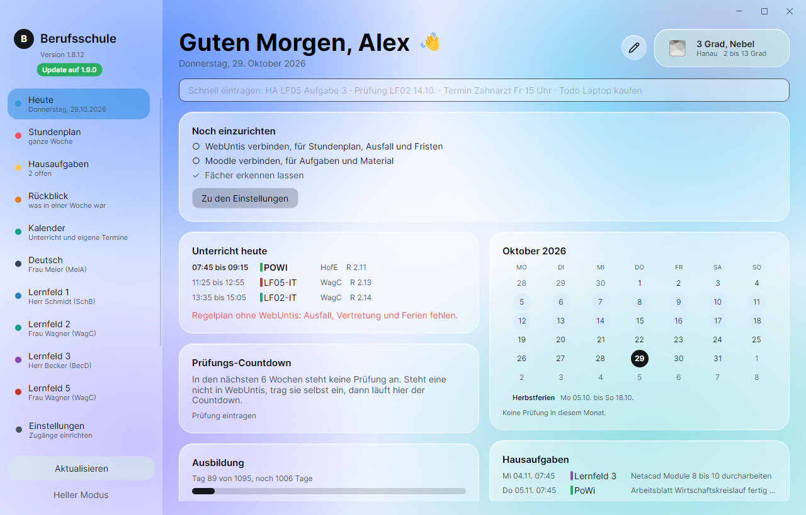
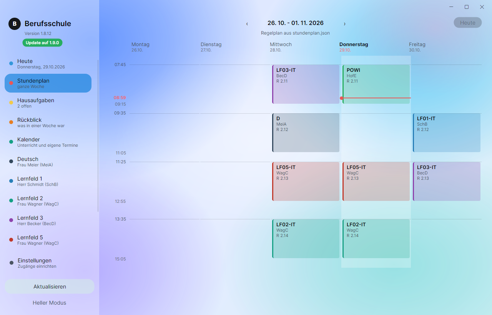
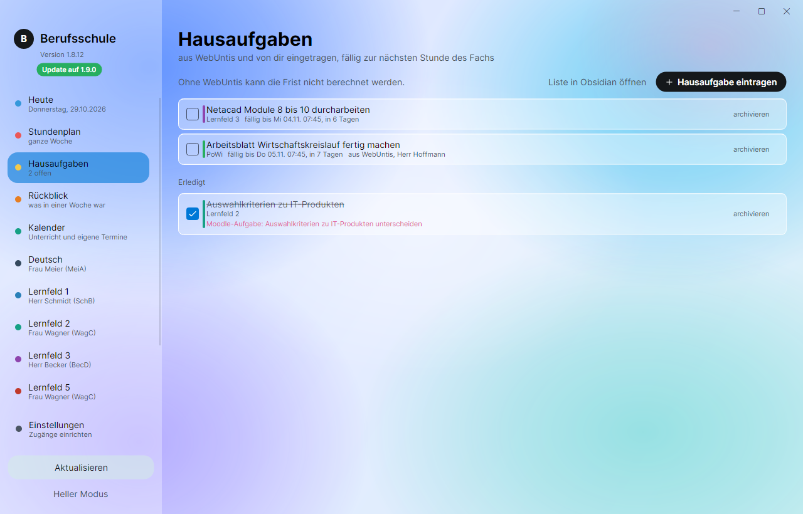
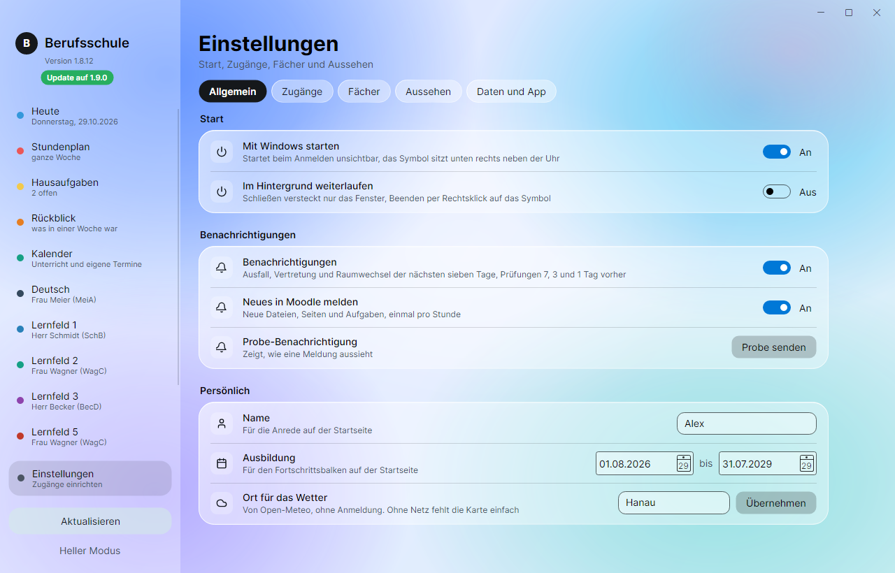
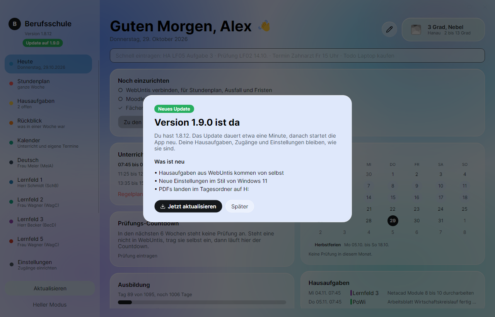

# Berufsschule

Windows-App für die Ludwig-Geissler-Schule: Stundenplan mit Ausfall und
Vertretung aus WebUntis, Moodle-Kurse mit Aufgaben, Textseiten und PDFs,
Hausaufgaben aus WebUntis und mit automatischer Frist, Kalender,
Prüfungs-Countdown und ein Wochenrückblick fürs Berichtsheft.

In diesem Repo liegen nur die fertigen Versionen, der Quellcode ist privat.

## So sieht sie aus

| Stundenplan | Hausaufgaben |
|---|---|
|  |  |
| **Einstellungen** | **Update beim Start** |
|  |  |

Die Bilder zeigen Beispieldaten, keine echten Namen oder Stundenpläne.

## Herunterladen

Unter **[Releases](https://github.com/flo12212/Berufsschule-Releases/releases/latest)**
die neueste `Berufsschule-x.y.z.zip` laden, entpacken und `Berufsschule.exe`
starten. Keine Installation, keine Adminrechte. Auf dem Schulrechner am besten
nach `H:\` entpacken, dann ist sie an jedem Schulrechner da.

Beim ersten Start meldet Windows „Der Computer wurde geschützt“, weil die Datei
nicht signiert ist. Auf „Weitere Informationen“ und dann „Trotzdem ausführen“.
Das kommt nur einmal, Updates aus der App heraus fragen nicht mehr nach.

Was du zum Einrichten brauchst, steht in der `LIESMICH.txt` in der ZIP.
Kurz: Benutzername und Untis-Mobile-Schlüssel aus WebUntis (Profil,
Freigaben) und deinen Moodle-Zugang. Die App führt beim ersten Start durch alles.

## Updates

Ab Version 1.8.13 sagt die App beim Start groß „Version x ist da“ und zeigt,
was neu ist. Ein Klick auf „Jetzt aktualisieren“ lädt das Update, tauscht die
App aus und startet sie neu. Deine Hausaufgaben, Zugänge und Einstellungen
bleiben, wie sie sind.

Bei älteren Versionen steht oben in der Seitenleiste nur ein grüner Hinweis.
Dann einmal die neue ZIP von hier laden und über die alte entpacken, ab da geht
es von selbst.

## Datenschutz

Zugangsdaten bleiben verschlüsselt auf deinem Rechner. Die App spricht nur mit
WebUntis, Moodle, Open-Meteo (Wetter) und hier mit GitHub für Updates.
Es gibt keinen eigenen Server und kein Tracking.

## Hinweis

Gemacht von Florian Taschke (10 IT 2). Kein offizielles Angebot der Schule,
von Untis oder von Moodle.